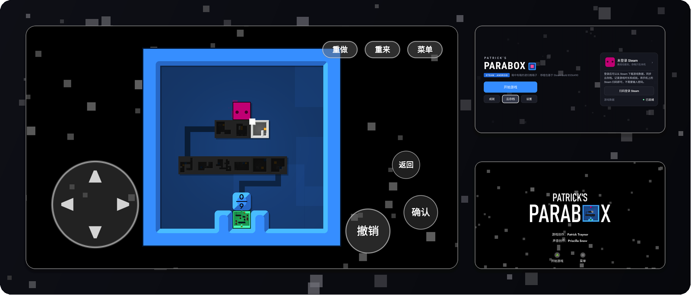
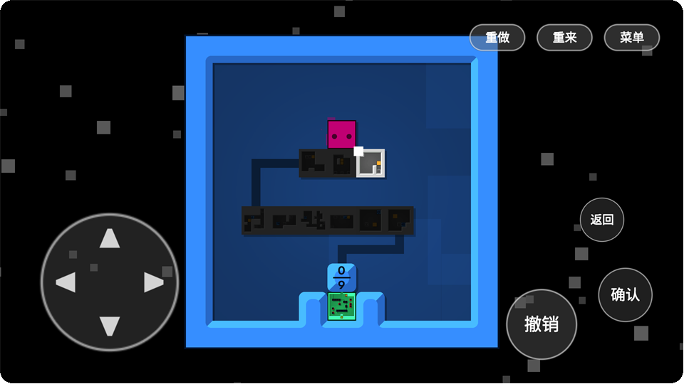
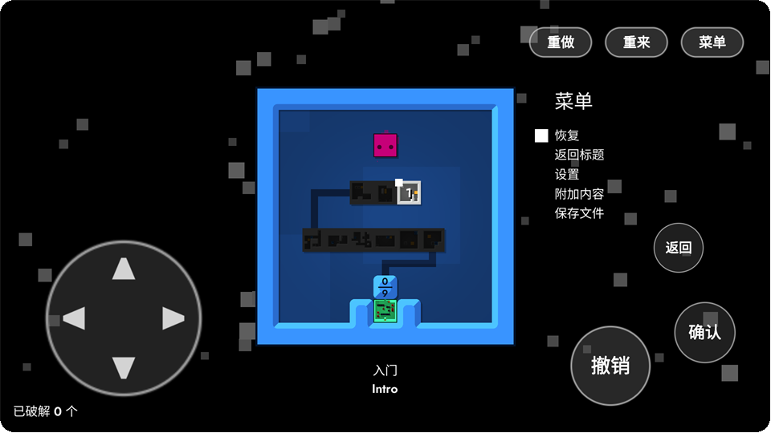
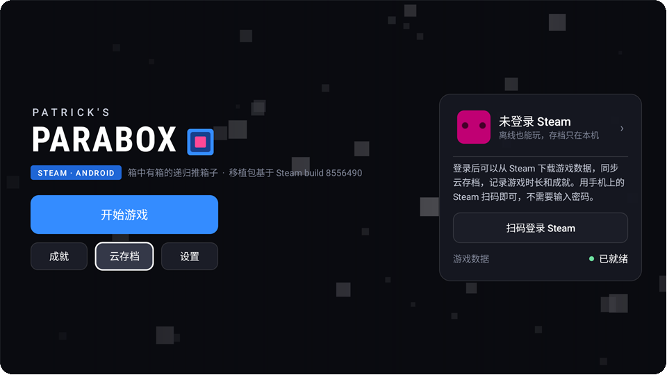
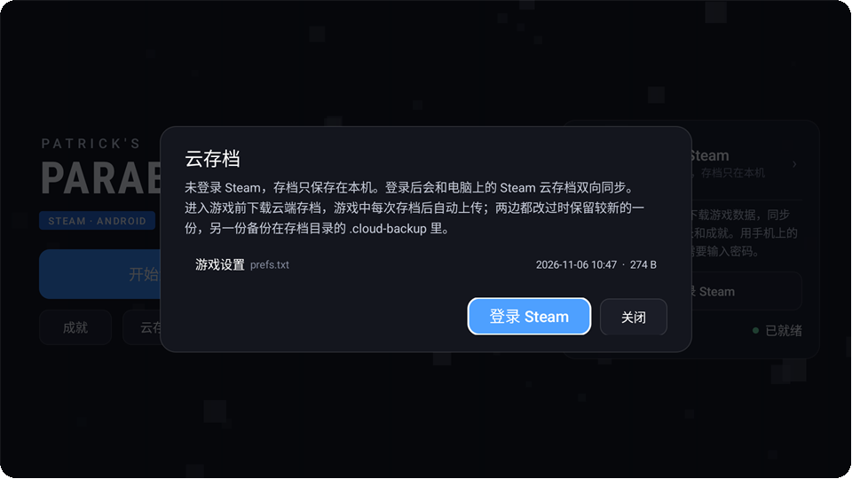
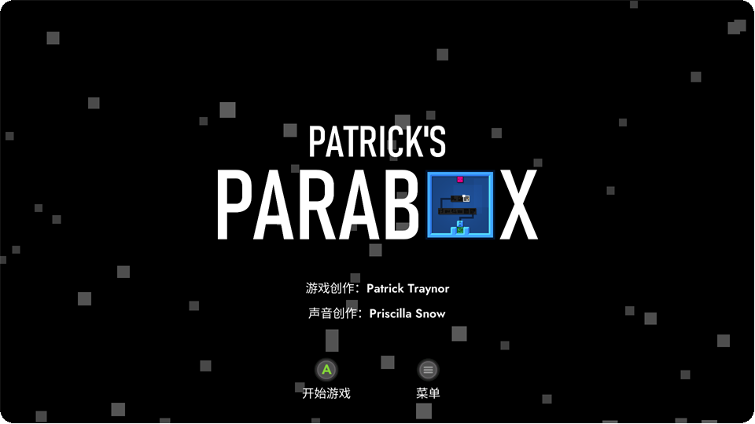
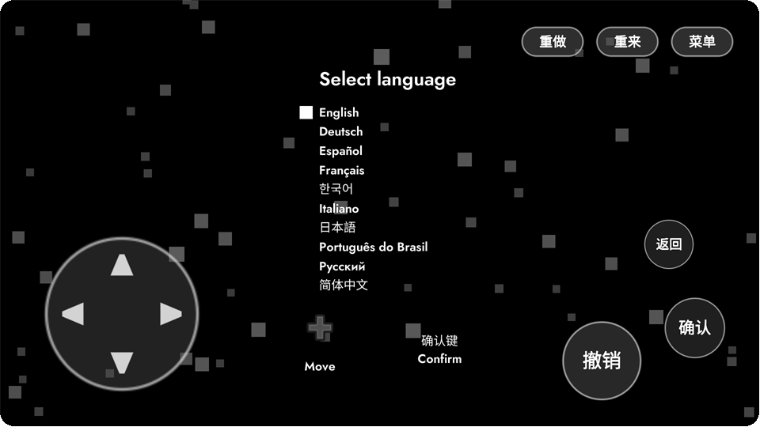
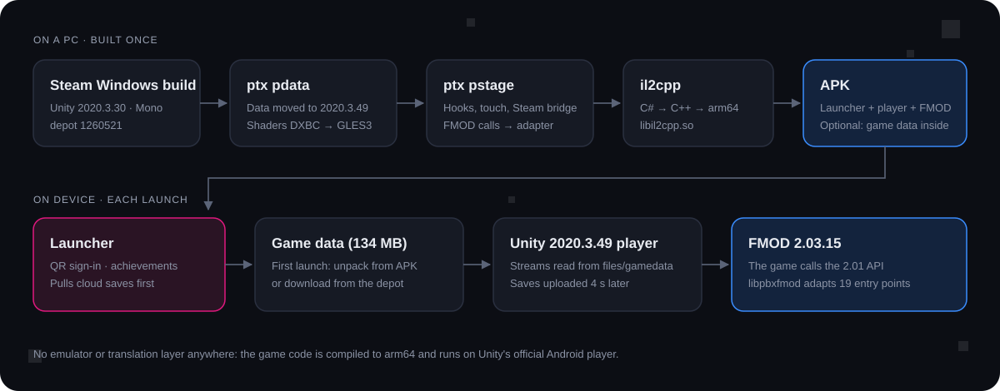

<div align="center">


# Patrick's Parabox · Android

[简体中文](README.md) · **English**

A native Android port of the Steam (Windows) version of *Patrick's Parabox*.<br>
No emulator and no translation layer: the game code is compiled to arm64 and runs on Unity's own Android player.

   

</div>

<br>

<p align="center"></p>

<br>

## What this is

*Patrick's Parabox* is Patrick Traynor's recursive box-pushing puzzle game: boxes contain levels, and you can push a box into another box, or walk into one yourself. It shipped on PC and Switch. This repository moves the Steam PC build to Android as a whole. The game data is used as is, the code is recompiled from Mono to IL2CPP, sound goes through FMOD's official Android libraries, and a small launcher in front of the game handles signing in to Steam.

The main target is the AYN Thor, which has built-in controls. Regular phones work too, since the port adds a complete set of touch controls.

> [!NOTE]
> This repository contains **no game files**, only the porting tools, patches and launcher source. To build it you need to own the game on Steam, and what you build is for your own use.

The launcher UI is currently in Simplified Chinese only. The game itself keeps all of its original languages.

<br>

## Screenshots

<table>
  <tr>
    <td width="50%"></td>
    <td width="50%"></td>
  </tr>
  <tr>
    <td><sub><b>Touch controls.</b> D-pad bottom left; undo, confirm and back bottom right; redo, restart and menu top right. Swiping on empty space also moves.</sub></td>
    <td><sub><b>Pause menu.</b> Menus only read the direction and confirm inputs, so the on-screen buttons write straight into the game's input fields, the same path a gamepad takes.</sub></td>
  </tr>
  <tr>
    <td></td>
    <td></td>
  </tr>
  <tr>
    <td><sub><b>Launcher.</b> Colors and drifting squares follow the game's title screen. The card on the right shows your Steam avatar, playtime and achievement progress.</sub></td>
    <td><sub><b>Cloud saves.</b> Two-way sync with Steam Cloud on your PC. If both sides changed, the newer copy wins and the other is kept as a backup.</sub></td>
  </tr>
  <tr>
    <td></td>
    <td></td>
  </tr>
  <tr>
    <td><sub><b>Title screen in Chinese.</b> The game ships its own translations; nothing was added.</sub></td>
    <td><sub><b>Language select.</b> Without a gamepad, the prompts switch to the game's own d-pad icon.</sub></td>
  </tr>
</table>

<br>

## Features

**The game**
- The full game, with all of its built-in languages.
- Sound: music and effects run through FMOD, with the game's original layering and reverb.
- Gamepad: works out of the box, and button prompts show gamepad icons.
- Touch: d-pad, undo, confirm, back, redo, restart and menu, plus swipe-to-move, with multi-touch. The buttons appear when no gamepad is in use and hide once you pick one up. Three button sizes.
- Frame-rate cap of 30, 60, 90 or 120; render scale of 100%, 85% or 70%.

**Steam**
- Sign in by scanning a QR code with the Steam mobile app; no password is typed into the app. You can also play without signing in, and saves then stay on the device.
- Cloud saves: the cloud copy is pulled before the game starts, and every in-game save is uploaded.
- Achievements: anything you unlock in game is reported to Steam. The launcher lists all 22 achievements with names, icons and unlock dates.
- Playtime is counted on Steam.

**Game data**
- Bundled build: the 134 MB of data goes inside the APK and is unpacked on first launch in a few seconds, with no network needed.
- Download build: the APK is only 64 MB, and on first launch it downloads the original files from the game's Steam depot. Every file is checked against its SHA-1, and files that already finished are not downloaded again after an interruption.
- Game updates on Steam: if an update only touches those six data files, the device updates them in place. If it changes code or levels, the APK has to be rebuilt on a PC, and the launcher says so.

<br>

## How it works

<p align="center"></p>

The port is a handful of separate pieces, each solving one concrete problem.

### 1. Running 2020.3.30 data on a 2020.3.49 player

The only Unity Android player on hand was 2020.3.49, left over from another port. Comparing type hashes class by class showed that 30 of the 33 engine classes in the data are identical. The other three (GraphicsSettings, PlayerSettings, BuildSettings) differ by a field or two, so `ptx pdata` re-serializes them by field name. There was no need to install 2020.3.30.

There is one custom shader. With Unity's built-in ones that comes to 192 variants, and hlslcc converted every one of them from DXBC to GLES3.

### 2. Weaving (Mono.Cecil)

`ptx pstage` patches the game's assemblies at the IL level before handing them to il2cpp:

- **Steamworks.NET**: all 902 P/Invokes become no-ops. The real Steam work happens in the launcher's Java layer (built on [JavaSteam](https://github.com/Longi94/JavaSteam)); the game side only tells it when a save is written or an achievement is unlocked.
- **Input System**: 1.2.0 is swapped for a 1.5.1 build compiled for Android. Only two serialized objects differ in layout, and those are fixed byte by byte.
- **Touch**: the game actually has a set of mobile buttons, but they are cleared by `buttons.Clear()` right after loading. Rather than revive them, a hook at the end of `Controls.Update` ORs the touch state into the game's 20 input fields, so levels, menus and the pause menu all work.
- **PC-only display options**: the settings file synced from a PC carries window mode and vsync. On Android those are ignored.

### 3. Texture streams outside the APK

The `*.resS` files and FMOD banks add up to 134 MB. `ptx respath` rewrites the external stream path of 623 objects to an absolute path on the device, `/data/data/…/files/gamedata/`, which Unity 2020 reads directly. The data can then come from a Steam download or from inside the APK, and the game code does not need to tell the difference.

### 4. An FMOD 2.01 game on the 2.03 libraries

The game's C# wrapper is FMOD 2.01.11, but the Android libraries you can download today are 2.03.15. Comparing all 570 imported functions and the 21 structs that cross the boundary left only these incompatibilities:

| Change in 2.03 | How it is handled |
| --- | --- |
| `System_Create` takes a version argument, and Studio's create checks it | Pass the 2.03 version to both |
| `GetVersion` gained a build-number argument | Report 2.01.11 to the game |
| Both `GetCPUUsage` calls now return a struct | Unpack it into the old floats |
| `GetMinimumDistance` / `GetMaximumDistance` merged | Call `GetMinMaxDistance` and return the one asked for |
| `HasCue` / `TriggerCue` renamed | Forward to `HasSustainPoint` / `KeyOff` |
| `FMOD_ADVANCEDSETTINGS` grew at the end, and FMOD checks cbSize | Read the full struct, overwrite only the 2.01 part |
| `PARAMETER_DESCRIPTION` gained a trailing `guid` | Receive into a temporary struct, copy back the 2.01 size |

That adapter is `tools/fmodshim/pbxfmod.c`, a bit over 200 lines of C built as `libpbxfmod.so`. Weaving points these 19 DllImports at it; the other 550 or so go straight to 2.03. Banks built with 2.01 load fine in the 2.03 runtime.

<br>

## Building

You need a Windows PC; the scripts run in Git Bash. Tools:

| Tool | Used for |
| --- | --- |
| Unity 2020.3.49 Android player and il2cpp | Runtime and code compilation |
| Android NDK r19c (for il2cpp), NDK 28 (for the adapter) | Native builds |
| Android SDK build-tools 36, JDK 21 | Packaging, signing, building the launcher |
| .NET 8 SDK | Building the `ptx` tool |
| hlslcc | Shader conversion |
| FMOD Engine 2.03.15 Android SDK | Download from fmod.com (account required) |
| 7-Zip | Assembling the APK |

The Android SDK location comes from `ANDROID_HOME`, or from a `local.env` file at the repository root (not committed), e.g. `ANDROID_HOME=/c/Android/sdk`. Other paths (Unity, the game folder, the work folder) are set for my machine in the first lines of `tools/*.sh`; change them before building elsewhere.

```bash
cd tools

# Game data: only needed again after a game update
dotnet <work>/ptx-bin/ptx.dll pdata "<Steam>/Patrick's Parabox/Patrick's Parabox_Data" <work>/data ...
bash make-port.sh                      # records the depot manifest and every file's SHA-1

# FMOD libraries and the adapter
bash fmodshim/build.sh

# code → il2cpp → APK (arm64; the il2cpp step takes about 2 minutes)
bash rebuild.sh                        # download build
BUNDLE=1 bash build-apk.sh             # bundled build: the 134 MB of data goes into the APK
```

Every command, its arguments, and the reasoning behind each step are in [HANDOFF.md](HANDOFF.md) (in Chinese).

<br>

## Layout

```
cloud/                 Launcher and Steam module (Java, compiled with plain javac, no Gradle)
  src/…/LauncherActivity.java   Launcher
  src/…/GameData.java           Data install: unpack from APK / download from Steam / verify
  src/…/CloudSync.java          Cloud save sync
  src/…/SteamProfile.java       Avatar, achievements, playtime
tools/
  ptx/                 Data conversion and assembly weaving (C#, Mono.Cecil + AssetsTools)
    Hooks.cs           Every change on the game side lives here
  paraboxandroid/      C# injected into the game: Bridge (talks to the launcher), TouchPad
  fmodshim/            FMOD 2.01 → 2.03 adapter
  java/                Entry activity
  pad/                 Virtual gamepad and touchscreen scripts for testing
  *.sh                 Build scripts
art/                   App icon
shots/                 Test screenshots
```

<br>

## Status

| Where | State |
| --- | --- |
| Emulator (x86_64) | The whole flow works: fresh install, data unpack, Chinese title screen, into a level; every touch button; FMOD master bus has signal, no errors |
| AYN Thor | Installed: QR sign-in and cloud sync work; sound, frame rate and touch feel are being tested |
| Known issue | The download build had a path-separator bug on Android (fixed, waiting for a re-test on device), so the Thor currently runs the bundled build |

<br>

## Credits

- Game by Patrick Traynor, sound by Priscilla Snow. Please buy it: [Steam store page](https://store.steampowered.com/app/1260520/)
- [JavaSteam](https://github.com/Longi94/JavaSteam): Steam sign-in, cloud saves and depot downloads in the launcher
- [AssetsTools.NET](https://github.com/nesrak1/AssetsTools.NET), [Mono.Cecil](https://github.com/jbevain/cecil): asset and assembly processing
- [hlslcc](https://github.com/Unity-Technologies/HLSLcc): shader conversion
- FMOD Studio by Firelight Technologies

<sub>This is a personal port, not affiliated with the game's author or with Valve. The game is the property of its author.</sub>
