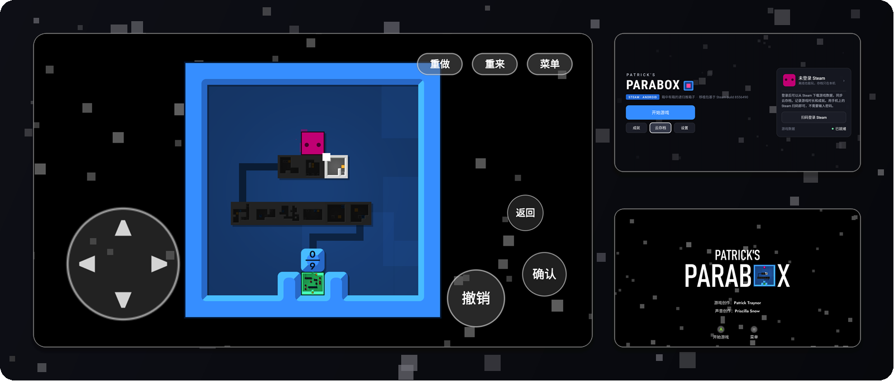
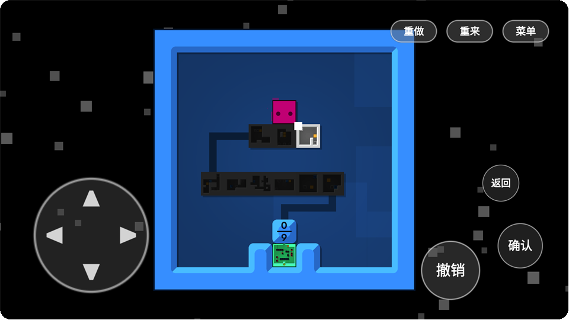
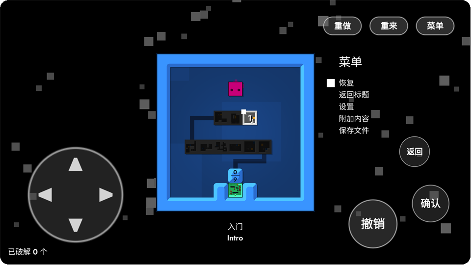
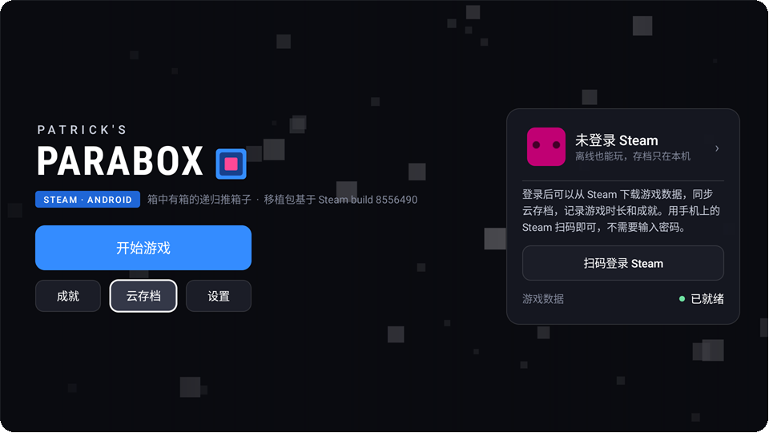
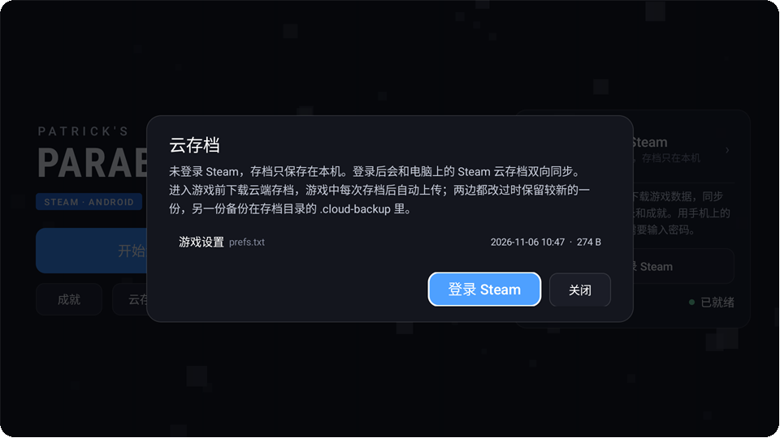
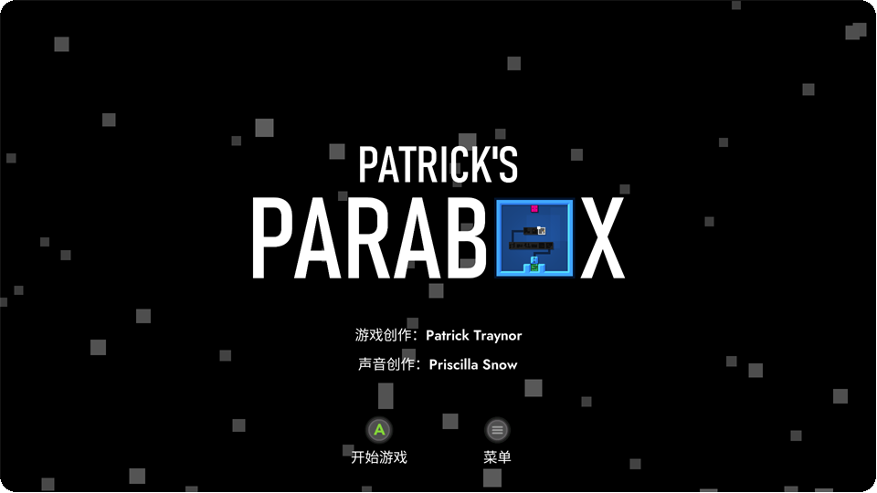
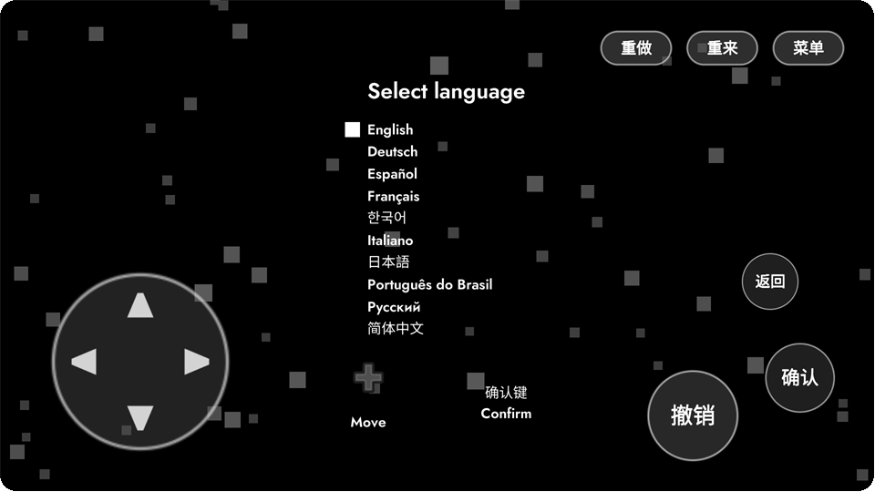
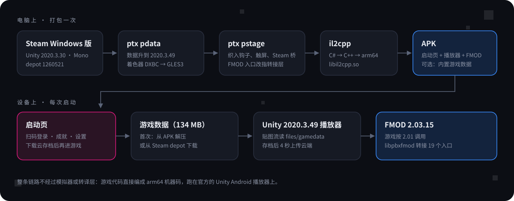

<div align="center">


# Patrick's Parabox · Android

**简体中文** · [English](README.en.md)

把 Steam 上的 Windows 版《Patrick's Parabox》原生移植到 Android。<br>
没有模拟器，也没有转译层：游戏代码编成 arm64 机器码，跑在 Unity 官方的 Android 播放器上。

   

</div>

<br>

<p align="center"></p>

<br>

## 这是什么

《Patrick's Parabox》是 Patrick Traynor 做的递归推箱子：箱子里面还有关卡，你可以推着箱子走进箱子。游戏出过电脑版和 Switch 版，这个仓库把电脑上的 Steam 版整个搬到 Android：游戏数据原样使用，代码从 Mono 改成 IL2CPP 编译，声音用 FMOD 官方的 Android 库，外面再套一个能登录 Steam 的启动页。

主要的目标设备是 AYN Thor（自带手柄）；普通手机也能玩，因为补了一套完整的触屏操作。

> [!NOTE]
> 仓库里**没有任何游戏文件**，只有移植用的工具、补丁和启动页源码。打包需要你自己在 Steam 上拥有这款游戏，产物只供个人使用。

<br>

## 截图

<table>
  <tr>
    <td width="50%"></td>
    <td width="50%"></td>
  </tr>
  <tr>
    <td><sub><b>触屏操作。</b>左下方向盘，右下撤销 / 确认 / 返回，右上重做 / 重来 / 菜单。空白处滑动也能走。</sub></td>
    <td><sub><b>暂停菜单。</b>菜单只认方向键和确认键，所以屏幕按键直接写进游戏的输入字段，和手柄走同一条路。</sub></td>
  </tr>
  <tr>
    <td></td>
    <td></td>
  </tr>
  <tr>
    <td><sub><b>启动页。</b>配色和漂浮的方块照着游戏标题画面做。右边是 Steam 卡片：头像、游戏时长、成就进度。</sub></td>
    <td><sub><b>云存档。</b>和电脑上的 Steam 云双向同步，两边都改过时保留较新的一份，另一份留作备份。</sub></td>
  </tr>
  <tr>
    <td></td>
    <td></td>
  </tr>
  <tr>
    <td><sub><b>简体中文标题画面。</b>游戏自带的中文，无需额外汉化。</sub></td>
    <td><sub><b>语言选择。</b>没有手柄时，提示会换成游戏自带的十字键图标。</sub></td>
  </tr>
</table>

<br>

## 功能

**游戏本身**
- 完整的游戏内容和自带的简体中文。
- 声音：音乐和音效都走 FMOD，按游戏原来的逻辑分层和混响。
- 手柄：直接用，按键提示显示手柄图标。
- 触屏：方向盘、撤销、确认、返回、重做、重来、菜单，加上滑动移动，支持多指。没接手柄时自动显示，用了手柄就自动藏起来。按键大小分小、中、大三档。
- 帧率上限可选 30、60、90、120，渲染分辨率可选 100%、85%、70%。

**Steam**
- 用手机上的 Steam 扫码登录，不需要输入密码。不登录也能玩，存档只留在本机。
- 云存档：进游戏前先拉取云端存档，游戏里每次存档后自动上传。
- 成就：游戏里解锁的成就会同步到 Steam。启动页能看全部 22 个成就，显示中文名、图标和解锁日期。
- 游戏时长：会计入 Steam。

**游戏数据**
- 内置包：134 MB 数据直接打进 APK，第一次启动时解压，几秒钟就好，不用联网。
- 下载版：APK 只有 64 MB，第一次启动时从 Steam 的 depot 下载原版文件，每个文件都校验 SHA-1，中断后已完成的文件不用重下。
- Steam 上的游戏更新：如果只改了这 6 个数据文件，设备上会增量更新；如果改了代码或关卡，就需要在电脑上重新打包（启动页会给出提示）。

<br>

## 怎么做的

<p align="center"></p>

整个移植分成几块，每块解决一个具体问题。

### 1. 用手头的 2020.3.49 播放器跑 2020.3.30 的数据

本机只有 Unity 2020.3.49 的 Android 播放器（来自另一个移植项目）。逐个比对类型哈希后发现，数据里 33 个引擎类有 30 个完全一致。剩下的 GraphicsSettings、PlayerSettings、BuildSettings 只差一两个字段，`ptx pdata` 按字段名把它们重新序列化一遍就行，所以不需要另装 2020.3.30。

着色器只有 1 个是自定义的，加上内置的共 192 个变体，用 hlslcc 从 DXBC 转成 GLES3，全部转换成功。

### 2. 织入（Mono.Cecil）

`ptx pstage` 在 IL 层改游戏的程序集，再交给 il2cpp：

- **Steamworks.NET** 的 902 个 P/Invoke 全部换成空实现。真正的 Steam 功能由启动页的 Java 层完成（基于 [JavaSteam](https://github.com/Longi94/JavaSteam)），游戏侧只在存档、解锁成就时通知它。
- **Input System** 从 1.2.0 换成为 Android 编译的 1.5.1。序列化布局只有两个对象不一样，直接按字节修正。
- **触屏**：游戏其实写过一套手机按键，可是加载完马上被 `buttons.Clear()` 清掉了。这里没有去复活它，而是在 `Controls.Update` 末尾把触屏状态按位或进游戏的 20 个输入字段，这样关卡、菜单、暂停菜单都能用。
- **电脑专属的显示选项**：从电脑同步过来的设置里带着窗口模式、垂直同步，这些在手机上一律不生效。

### 3. 贴图流放到 APK 外面

`*.resS` 和 FMOD 的 bank 一共 134 MB。`ptx respath` 把 623 个对象的外部流路径改成设备上的绝对路径 `/data/data/…/files/gamedata/`，Unity 2020 可以直接从那里读取。这样数据可以从 Steam 下载，也可以从 APK 里解压，游戏代码不用区分。

### 4. 让 FMOD 2.01 的游戏用上 2.03 的库

游戏的 C# 封装是 FMOD 2.01.11，但现在能下载到的 Android 库是 2.03.15。比对 570 个导入函数和 21 个跨边界的结构体后，真正不兼容的只有这些：

| 改动 | 处理 |
| --- | --- |
| `System_Create` 新增版本参数，Studio 的 create 会核对版本号 | 都传 2.03 的版本号 |
| `GetVersion` 新增 build 参数 | 对游戏报 2.01.11 |
| 两个 `GetCPUUsage` 改成返回结构体 | 拆回原来的几个 float |
| `GetMinimumDistance` / `GetMaximumDistance` 合并 | 调 `GetMinMaxDistance`，按需返回其中一个 |
| `HasCue` / `TriggerCue` 改名 | 转到 `HasSustainPoint` / `KeyOff` |
| `FMOD_ADVANCEDSETTINGS` 末尾多了字段，会检查 cbSize | 先取完整结构，只覆盖 2.01 的那部分 |
| `PARAMETER_DESCRIPTION` 末尾多了 `guid` | 用临时结构接收，再按 2.01 的大小拷回 |

`tools/fmodshim/pbxfmod.c` 就是这层转接，两百多行 C 代码，编成 `libpbxfmod.so`。织入时把这 19 个 DllImport 改指向它，其余 550 多个入口直接调用 2.03。用 2.01 打包的 bank 在 2.03 的运行时里可以正常加载。

<br>

## 构建

需要一台 Windows 电脑，在 Git Bash 里执行。依赖的工具：

| 工具 | 用途 |
| --- | --- |
| Unity 2020.3.49 的 Android 播放器和 il2cpp | 运行时和代码编译 |
| Android NDK r19c（il2cpp 用）、NDK 28（编转接层） | 原生编译 |
| Android SDK build-tools 36、JDK 21 | 打包、签名、编译启动页 |
| .NET 8 SDK | 编译 `ptx` 工具 |
| hlslcc | 着色器转换 |
| FMOD Engine 2.03.15 Android SDK | 要在 fmod.com 登录后下载 |
| 7-Zip | 组装 APK |

Android SDK 的位置从 `ANDROID_HOME` 读取，也可以写进仓库根目录的 `local.env`（不入库），例如 `ANDROID_HOME=/c/Android/sdk`。其余路径（Unity、游戏目录、工作目录）是按我自己的机器写的，在 `tools/*.sh` 开头几行，换机器要先改。

```bash
cd tools

# 游戏数据：只在游戏更新后才需要重跑
dotnet <work>/ptx-bin/ptx.dll pdata "<Steam>/Patrick's Parabox/Patrick's Parabox_Data" <work>/data ...
bash make-port.sh                      # 记录 depot 清单和每个文件的 SHA-1

# FMOD 库和转接层
bash fmodshim/build.sh

# 代码 → il2cpp → APK（arm64，il2cpp 一步大约 2 分钟）
bash rebuild.sh                        # 下载版
BUNDLE=1 bash build-apk.sh             # 内置包：把 134 MB 数据打进 APK
```

完整的命令、参数和每一步的来龙去脉都写在 [HANDOFF.md](HANDOFF.md) 里。

<br>

## 目录

```
cloud/                 启动页和 Steam 模块（Java，javac 直接编译，不用 Gradle）
  src/…/LauncherActivity.java   启动页
  src/…/GameData.java           数据安装：APK 解压 / Steam 下载 / 校验
  src/…/CloudSync.java          云存档同步
  src/…/SteamProfile.java       头像、成就、游戏时长
tools/
  ptx/                 数据转换和程序集织入（C#，Mono.Cecil + AssetsTools）
    Hooks.cs           所有游戏侧的改动都在这里
  paraboxandroid/      注入游戏的 C# 代码：Bridge（与启动页通信）、TouchPad（触屏）
  fmodshim/            FMOD 2.01 → 2.03 转接层
  java/                入口 Activity
  pad/                 测试用的虚拟手柄、虚拟触屏脚本
  *.sh                 构建脚本
art/                   应用图标
shots/                 测试截图
```

<br>

## 现状

| 环境 | 情况 |
| --- | --- |
| 模拟器（x86_64） | 全部流程走通：从全新安装、解压数据、中文标题到进入关卡；触屏各个按键；FMOD 主混音有信号、没有报错 |
| AYN Thor | 已装机：扫码登录和云同步正常；声音、帧率、触屏手感还在实测 |
| 已知问题 | 下载版在 Android 上有路径分隔符的问题（已修，等待真机复测），所以目前 Thor 上装的是内置包 |

<br>

## 致谢

- 游戏：Patrick Traynor；声音：Priscilla Snow。请支持正版：[Steam 商店页](https://store.steampowered.com/app/1260520/)
- [JavaSteam](https://github.com/Longi94/JavaSteam)：启动页里的 Steam 登录、云存档和 depot 下载
- [AssetsTools.NET](https://github.com/nesrak1/AssetsTools.NET)、[Mono.Cecil](https://github.com/jbevain/cecil)：数据和程序集处理
- [hlslcc](https://github.com/Unity-Technologies/HLSLcc)：着色器转换
- FMOD Studio by Firelight Technologies

<sub>这是个人移植项目，与游戏作者和 Steam 无关。游戏的版权归原作者所有。</sub>
